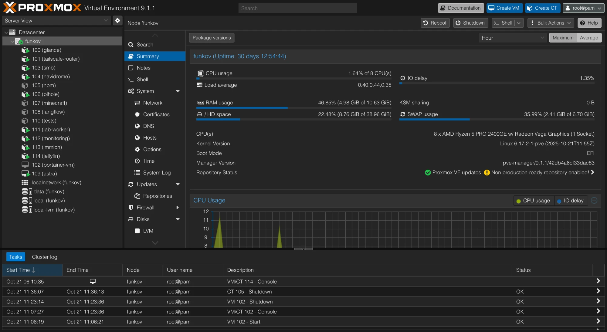
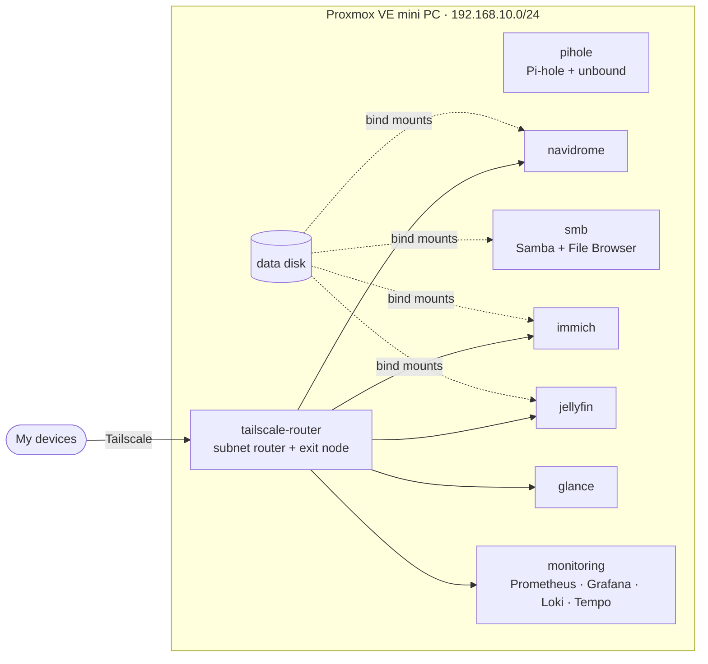
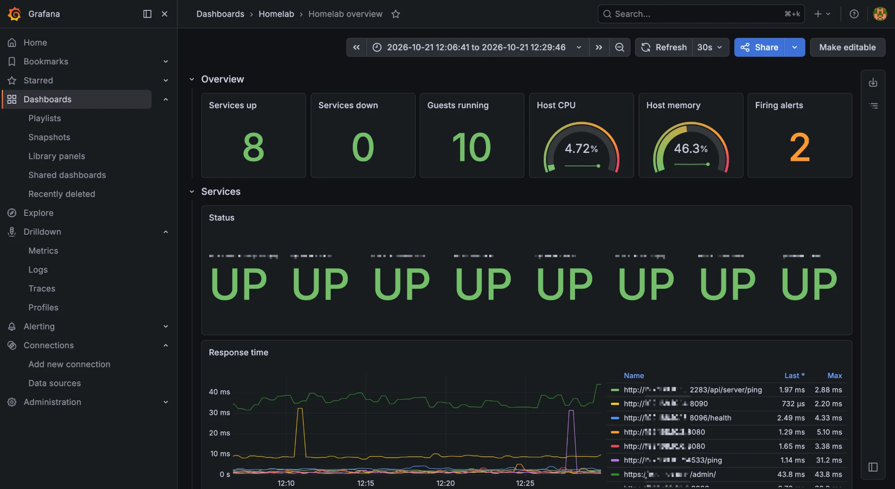
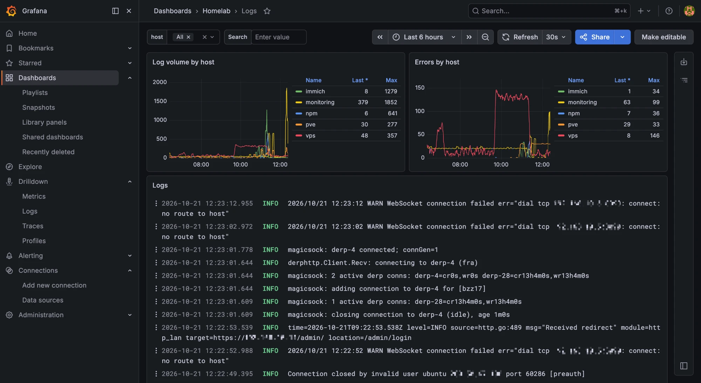
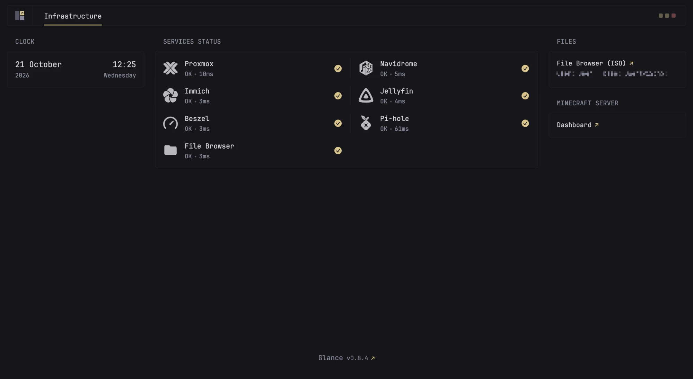

# Homelab

[](https://github.com/funkovx/homelab/actions/workflows/lint.yml)


My self-hosted infrastructure on a single mini PC (Ryzen 5 PRO 2400GE, 10 GB RAM) running Proxmox VE: photo backup, music streaming, a media server, file sharing, DNS filtering, and monitoring with metrics, service checks and logs. Every service runs in its own unprivileged LXC, reachable from anywhere over Tailscale. Docker stacks and guest configuration are kept here as code; the parts configured by hand are written up in [`docs/`](docs).



## Architecture



The home network sits behind CGNAT and nothing is published to the internet. My devices join the tailnet, and the `tailscale-router` LXC advertises the whole 192.168.10.0/24, so every service is reached at its LAN address from anywhere.

## What runs where

| ID | Type | Name | Resources | Role |
| --- | --- | --- | --- | --- |
| 100 | LXC | glance | 1 vCPU · 512 MB | [Glance](stacks/glance) start page with live status checks |
| 101 | LXC | tailscale-router | 1 vCPU · 512 MB | Tailscale subnet router and exit node |
| 102 | VM | portainer-vm | 2 vCPU · 4 GB | Old Immich VM, shut down, kept for a rollback until early November |
| 103 | LXC | smb | 2 vCPU · 1 GB | Samba shares and File Browser on the data disk |
| 104 | LXC | navidrome | 1 vCPU · 512 MB | Navidrome music server |
| 105 | LXC | npm | 1 vCPU · 1 GB | Nginx Proxy Manager, shut down: nothing is published through it any more |
| 106 | LXC | pihole | 1 vCPU · 512 MB | Pi-hole with unbound as a recursive resolver |
| 107 | LXC | minecraft | 4 vCPU · 5.5 GB | Minecraft server, usually stopped; rootfs on the HDD |
| 109 | VM | astra | 2 vCPU · 4 GB | Astra Linux VM |
| 111 | LXC | lab-worker | 2 vCPU · 4 GB | Worker for my Telegram bot |
| 112 | LXC | monitoring | 2 vCPU · 2 GB | [Prometheus, Grafana, Loki, Tempo](stacks/monitoring) and the [Beszel](stacks/beszel) hub |
| 113 | LXC | immich | 4 vCPU · 4 GB | [Immich](stacks/immich) photo backup, VA-API transcoding on the iGPU |
| 114 | LXC | jellyfin | 2 vCPU · 1.5 GB | [Jellyfin](stacks/jellyfin) films and series, VA-API transcoding on the iGPU |

The LXC containers are unprivileged Debian 12. Stopped experiments (108 langflow, 110 tests) are left out. Immich moved from its VM into an LXC, which frees about 4 GB of RAM ([how](docs/immich-vm-to-lxc.md)).


## Monitoring

- **Metrics:** node-exporter on the host and in every LXC, plus pve-exporter for the status and usage of each guest through the Proxmox API.
- **Service checks:** blackbox-exporter makes HTTP requests to every service on the LAN.
- **Logs:** Grafana Alloy ships the systemd journal and Docker logs to Loki.
- **Alerts:** down targets and services, stopped guests, memory pressure and swapping, full disks.

Grafana loads its data sources and dashboards from this repository. Details in [`stacks/monitoring`](stacks/monitoring).





## Repository layout

```
ansible/        inventory, roles (base, node_exporter, docker, alloy), stack deployment
stacks/         one docker compose project per service
  monitoring/   Prometheus, Grafana, Loki, exporters, alert rules, dashboards
docs/           how the hand-configured parts are set up
```

Secrets never enter the repository: each stack ships a `.env.example`, real `.env` files are git-ignored, and CI runs gitleaks on every push along with yamllint, `docker compose config`, `promtool` and ansible-lint.

## Notes

- [Moving Immich from a VM to an LXC](docs/immich-vm-to-lxc.md)
- [Jellyfin for films and series](docs/jellyfin.md)
- [Tailscale subnet router and exit node in an LXC](docs/tailscale-subnet-router.md)
- [Bind-mounting host folders into unprivileged LXC](docs/lxc-bind-mounts.md)
- [Sharing a host folder with a VM over VirtIO-FS](docs/virtiofs.md)
- [SFTPGo with WebDAV](docs/sftpgo-webdav.md)


