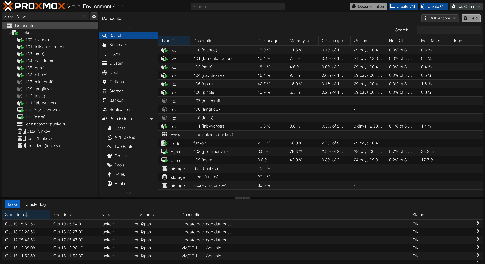
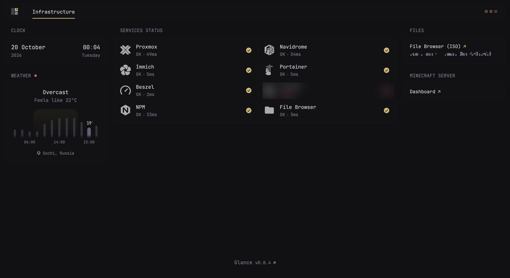
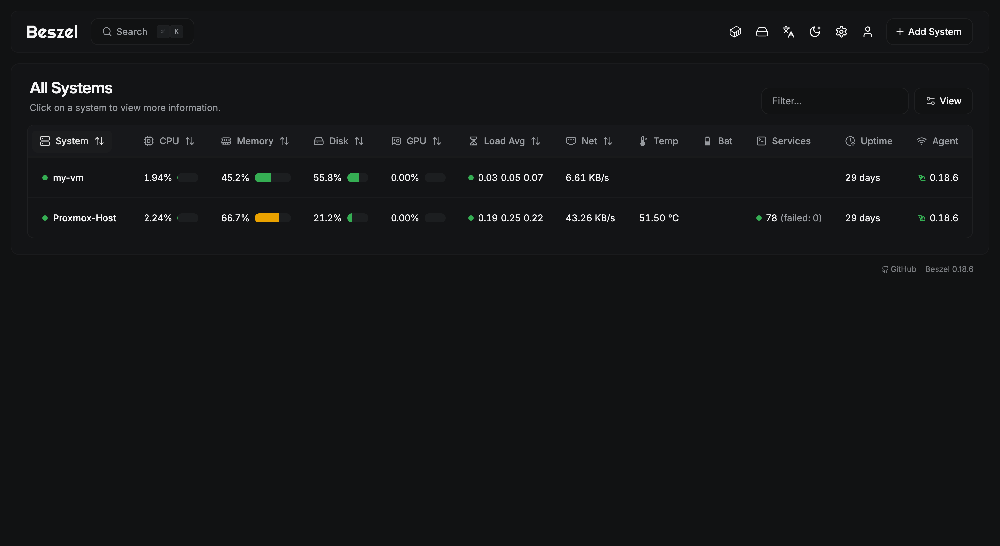

# 🏠 Homelab Infrastructure Documentation

## 📖 Overview
A private, high-availability home laboratory focused on media self-hosting, monitoring, and secure remote access. The infrastructure is built on **Proxmox VE** and utilizes a hybrid network topology combining local services with a cloud-based entry point.

---

## 🏗 Network Architecture

### External Access
* **Gateway:** Public VPS acting as a reverse proxy entry point.
* **Tunneling:** Secure **Tailscale** tunnel between VPS and local network. And configured exit-node for private access.

### Internal Management
* **Reverse Proxy:** Nginx Proxy Manager (NPM) handling SSL (Let's Encrypt) and subdomain routing.
* **DNS:** Local DNS filtering and resolution.

---

## 🛠 Deployed Services

| **Service** | **Category** | **Description** |
| :--- | :--- | :--- |
| **Proxmox VE** | Hypervisor | Bare-metal virtualization platform. |
| **Nginx Proxy Manager** | Gateway | SSL termination and subdomain management. |
| **Portainer** | Management | Docker container orchestration and UI. |
| **Immich** | Photos | Self-hosted photo/video backup service. |
| **Navidrome** | Media | Lightweight music streaming server (Subsonic compatible). |
| **Beszel** | Monitoring | Lightweight server resource monitoring hub. |
| **Pi-hole** | Security | Network-wide ad blocking and local DNS. |

---

## 📸 Screenshots

**Proxmox VE**: LXC containers and VMs for every service on a single node

**Glance dashboard** with live status checks for every service

**Beszel** monitoring the Proxmox host, a VM and the public VPS

---

## 🤝 Contributing
This is a personal project. Feel free to open an issue, or ask questions if you're interested in the specific `iptables` or `LXC` configuration files used in this setup.
