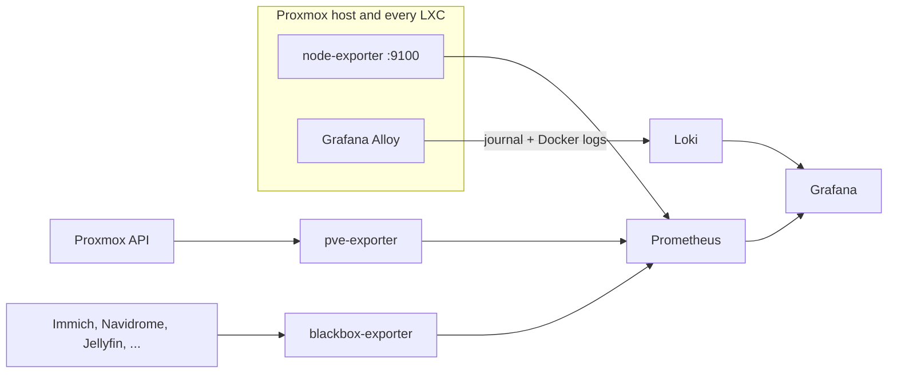

# Monitoring

Metrics, service checks and logs for the whole lab, in one LXC (`monitoring`, 192.168.10.14, 2 vCPU, 2 GB).



| Component | What it does |
| --- | --- |
| Prometheus | Scrapes every 30 s, keeps 15 days, evaluates the [alert rules](prometheus/rules/alerts.yml) |
| pve-exporter | Status, CPU, memory, disk and network of every LXC and VM through the Proxmox API |
| node-exporter | Host-level metrics on the Proxmox node and inside each LXC (installed by Ansible) |
| blackbox-exporter | HTTP checks of every service on the LAN |
| Loki | Logs from the systemd journal and Docker, shipped by Grafana Alloy, kept 14 days |
| Grafana | Provisioned dashboards: **Homelab overview**, **Logs** and **Schedule parser** (nginx logs of the public VPS) |

Every container has a memory limit, since the whole host has 10 GB.

## Deploy

1. Create the LXC:

   ```bash
   pct create 112 data:vztmpl/debian-12-standard_<version>_amd64.tar.zst \
     --hostname monitoring --cores 2 --memory 2048 --swap 512 \
     --rootfs local-lvm:16 --unprivileged 1 --features nesting=1,keyctl=1 \
     --net0 name=eth0,bridge=vmbr0,firewall=1,ip=192.168.10.14/24,gw=192.168.10.1 \
     --onboot 1 --ssh-public-keys ~/.ssh/authorized_keys
   pct start 112
   ```

2. Create a read-only API token on the Proxmox host:

   ```bash
   pveum user add prometheus@pve
   pveum aclmod / -user prometheus@pve -role PVEAuditor
   pveum user token add prometheus@pve monitoring --privsep 0
   ```

3. Run Ansible from [`ansible/`](../../ansible). The first run installs everything, copies the stack to `/opt/homelab/monitoring` and stops, asking for the secrets. On the LXC:

   ```bash
   cd /opt/homelab/monitoring
   cp .env.example .env   # token and Grafana password
   ```

   Then run the playbook again: `ansible-playbook playbooks/site.yml --limit monitoring`.

Grafana is on `:3000`, Prometheus on `:9090`. The dashboards are under **Homelab**.

## Alerts

| Alert | Fires when |
| --- | --- |
| TargetDown | A scrape target is unreachable for 5 minutes |
| ServiceDown | A service stops answering HTTP checks for 3 minutes |
| GuestStopped | A guest marked "start on boot" is not running |
| HostHighCpu | CPU stays above 90% for 15 minutes |
| HostLowMemory | Less than 10% of the host memory is available |
| HostSwapping | The host keeps swapping pages out |
| GuestMemoryHigh | A guest uses over 95% of its memory limit |
| DiskAlmostFull / GuestDiskAlmostFull | A filesystem or an LXC root disk is over 90% full |

Alerts show up in Prometheus and on the overview dashboard.

## Beszel

The Beszel hub ([`stacks/beszel`](../beszel)) runs in the same LXC as a quick glance at the host and the public VPS. When moving it from the old VM, copy its `beszel_data` folder along so the existing agents keep their keys.


